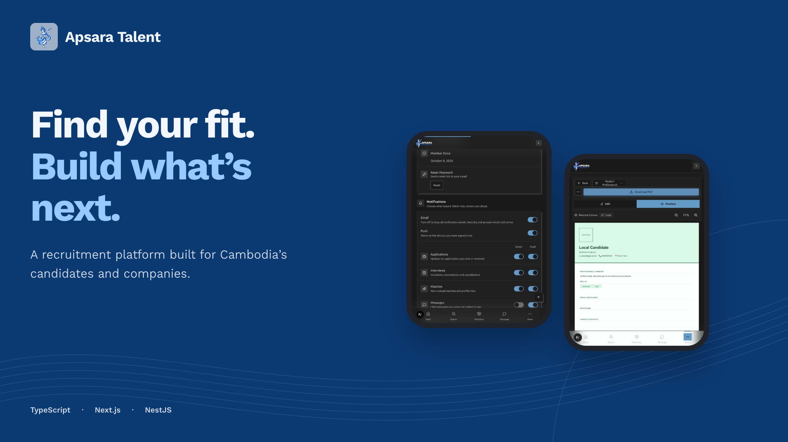
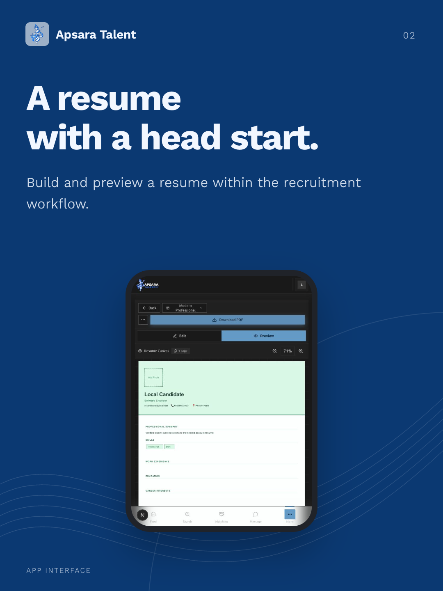
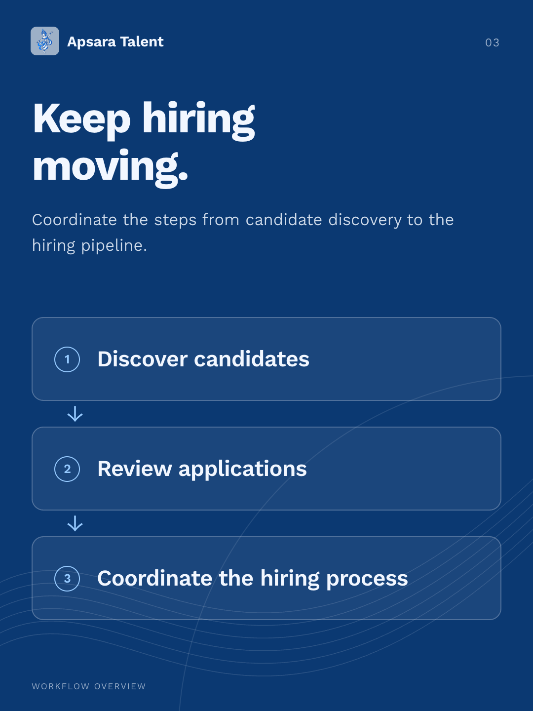

# Apsara Talent Web

The Next.js frontend for Apsara Talent, a Cambodia-focused platform connecting professionals and companies through profiles, matching, messaging, interviews, and AI-assisted resume tools.

<!-- product-images:start -->

## Product preview

<p align="center">
  
</p>

<table>
<tr>
  <td width="33%"></td>
  <td width="33%"></td>
  <td width="33%"></td>
</tr>
</table>

<!-- product-images:end -->

## Requirements

- Node.js 20.9 or newer
- npm 10 or newer
- A running Apsara Talent API

## Setup

```bash
npm ci
cp .env.example .env.local
npm run dev
```

The development server runs at [http://localhost:4000](http://localhost:4000).

## Checks

```bash
npm run check:env
npm run lint
npm test
npm run build
npm run test:e2e
```

`test:e2e` builds and starts the standalone production server unless `E2E_SKIP_BUILD=1` is set.

## Main directories

- `app` — Next.js routes, layouts, and route-level UI
- `components` — shared and feature components
- `hooks` — reusable client hooks
- `stores` — Zustand state and API integrations
- `utils` — types, validation, constants, and utilities
- `language` — English and Khmer translations
- `assets` — source-controlled images imported by the application
- `public` — files that must be served directly from the site root

## Environment

Copy `.env.example` to `.env.local` and provide the required API, Firebase, and monitoring values. Do not commit local environment files or credentials.

## Deployment

The repository supports Vercel and a standalone Docker image. Production builds use Next.js standalone output.
